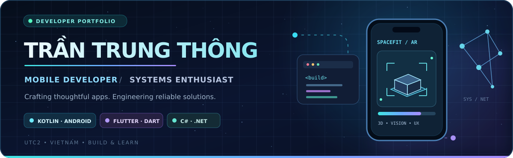
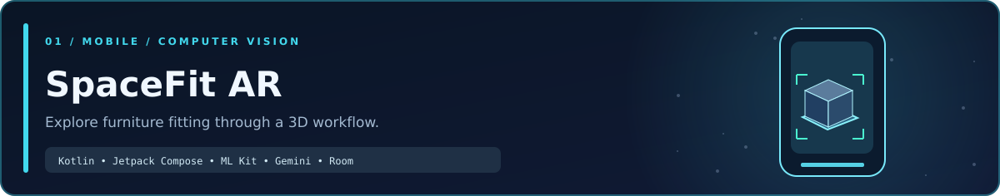

<!-- ===========================================================
     GitHub Profile — Trần Trung Thông
     GitHub: https://github.com/trunthong09012005
     To customize, edit text below and replace images in /assets.
     All featured projects link to real public repositories.
     =========================================================== -->

  

   

  
  
  

    

  

## 👋 About Me

> **Hi, I'm Trần Trung Thông.** An Information Technology student at **University of Transport and Communications – Campus 2 (UTC2)**, with a passion for building useful applications and understanding the systems behind them.

🇻🇳 Mình là sinh viên CNTT tại UTC2, tập trung vào phát triển ứng dụng di động, trải nghiệm người dùng và tìm hiểu hệ thống mạng.

- 📱 **Focus:** Android/mobile development, thoughtful UI/UX, and practical software engineering.
- 🧠 **Exploring:** Computer vision, AI-assisted features, and 3D interaction in mobile apps.
- 🖥️ **Also interested in:** Networking fundamentals, system administration, and maintainable applications.
- 🎯 **Goal:** Turn real problems into reliable, accessible, and polished software.
- 🌏 **Based in:** Vietnam.

<!-- OPTIONAL: Add an accurate CV, personal site or internship status here.
     Example: 📄 [My CV](https://your-real-cv-link)
-->

## 🧰 Technical Toolbox

**Mobile & App Development**

**Languages, Frameworks & Data**

**Developer Tools**

  
<b>More technologies & areas I'm exploring</b>

   
  Android Jetpack Compose · CameraX · Google ML Kit · Gemini API · Room Database · ASP.NET Core MVC · SQL · Windows Server · Computer Networks

## 🚀 Featured Projects

### 01 · SpaceFit AR — 3D Furniture Fitting Concept

An **Android application project** exploring how users can scan furniture from multiple angles, review an editable 3D representation, and evaluate its fit in a room. The project combines an AI-assisted visual workflow with local, rule-based geometry checks.

**What it demonstrates:** Android architecture · CameraX/ML Kit · Gemini-assisted recognition · Jetpack Compose · Room persistence · explainable spatial rules.

**[View source & documentation →](https://github.com/trunthong09012005/Ar-Spacefit)**

### 02 · ClubManageApp — Desktop Club Management

A **C# Windows Forms** application project with modules around member records, club activities, meetings, notifications, and operational workflows.

**What it demonstrates:** Desktop UI development · form-based workflows · application structure · database-oriented features.

**[Explore the repository →](https://github.com/trunthong09012005/ClubManageApp)**

### 03 · QuanLyCLB_LSC — Club Management on the Web

A **C#/.NET web application** with MVC-style organization, controllers, services, models, views, database scripts, and container configuration.

**What it demonstrates:** Layered web application structure · server-side development · data workflows · deployment-oriented tooling.

**[Explore the repository →](https://github.com/trunthong09012005/QuanLyCLB_LSC)**

Also built: <a href="https://github.com/trunthong09012005/QL_BANGCAP_CHUNGCHI">QL_BANGCAP_CHUNGCHI</a> — a C# desktop application project for managing degrees and certificates.

## 📊 GitHub Activity

  

   

  
  

Note: These statistics are generated by an external service and may occasionally be delayed or temporarily unavailable.

## 🤝 Let's Connect

  <b>Interested in building something useful together?</b>
    

  
  

  <!-- Recommended once you have real URLs:
  
  
  -->

    
  

