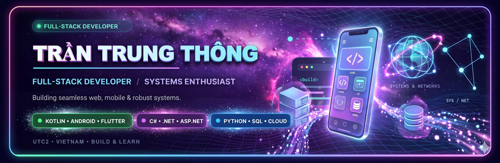
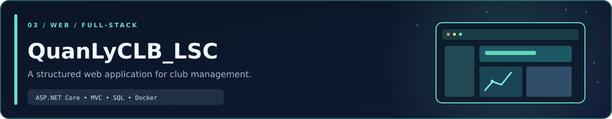
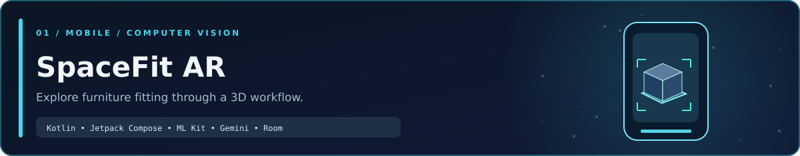
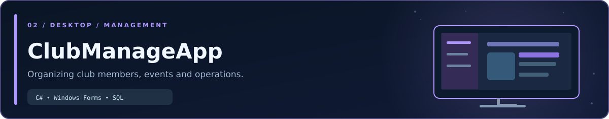

<!-- ===========================================================
     GitHub Profile — Trần Trung Thông
     GitHub: https://github.com/trunthong09012005
     To customize, edit text below and replace images in /assets.
     All featured projects link to real public repositories.
     =========================================================== -->

  <!-- Lưu bức ảnh banner mới về thư mục ./assets/hero.png (hoặc đổi lại thành hero.svg nếu bạn đã convert) -->
  

    

  
  
  

    

  

## 👋 About Me

> **Hi, I'm Trần Trung Thông.** An Information Technology student at **University of Transport and Communications – Campus 2 (UTC2)**, specializing in **Full-Stack & Mobile Development** with a strong passion for building scalable applications and understanding the systems behind them.

🇻🇳 Mình là sinh viên CNTT tại UTC2, định hướng phát triển Full-Stack (Web & Mobile), thiết kế trải nghiệm người dùng tối ưu và tìm hiểu sâu về quản trị hệ thống mạng.

- 💻 **Full-Stack Focus:** End-to-end web & mobile application development, clean architecture, and thoughtful UI/UX.
- 🧠 **Exploring:** Computer vision, AI-assisted features, cloud integration, and 3D interaction in apps.
- 🖥️ **Systems & Infra:** Networking fundamentals, system administration, databases, and containerized deployments.
- 🎯 **Goal:** Turn real-world problems into reliable, accessible, and polished end-to-end software solutions.
- 🌏 **Based in:** Vietnam.

<!-- OPTIONAL: Add an accurate CV, personal site or internship status here.
     Example: 📄 [My CV](https://your-real-cv-link)
-->

## 🧰 Technical Toolbox

**Mobile & Frontend Development**

**Backend, Languages & Databases**

**Systems, DevOps & Developer Tools**

  
<b>More technologies & areas I'm exploring</b>

   
  ASP.NET Core MVC & Web API · Android Jetpack Compose · RESTful APIs · CameraX · Google ML Kit · Gemini API · Room Database · Entity Framework Core · SQL Server · Windows Server · Computer Networks

## 🚀 Featured Projects

### 01 · QuanLyCLB_LSC — Full-Stack Club Management Web App

A **Full-Stack C#/.NET web application** built with MVC architecture, featuring responsive frontend views, backend controllers, business logic services, relational database scripts, and Docker container configuration.

**What it demonstrates:** Full-stack web architecture · ASP.NET Core MVC · database design & data workflows · containerized deployment.

**[Explore the repository →](https://github.com/trunthong09012005/QuanLyCLB_LSC)**

### 02 · SpaceFit AR — 3D Furniture Fitting Mobile Concept

An **Android application project** exploring how users can scan furniture from multiple angles, review an editable 3D representation, and evaluate its fit in a room. Combines an AI-assisted visual workflow with local, rule-based geometry checks.

**What it demonstrates:** Mobile architecture · CameraX/ML Kit · Gemini API integration · Jetpack Compose · Room persistence · spatial geometry rules.

**[View source & documentation →](https://github.com/trunthong09012005/Ar-Spacefit)**

### 03 · ClubManageApp — Desktop Management System

A **C# Windows Forms** system designed with comprehensive modules for member records, club activities, scheduling, notifications, and internal operational workflows.

**What it demonstrates:** Desktop software engineering · multi-module workflows · application state & database integration.

**[Explore the repository →](https://github.com/trunthong09012005/ClubManageApp)**

Also built: <a href="https://github.com/trunthong09012005/QL_BANGCAP_CHUNGCHI">QL_BANGCAP_CHUNGCHI</a> — a C# desktop application for managing degrees and certificates.

## 📊 GitHub Activity

  

   

  
  

Note: These statistics are generated by an external service and may occasionally be delayed or temporarily unavailable.

## 🤝 Let's Connect

  <b>Interested in building something useful together?</b>
    

  
  

  <!-- Recommended once you have real URLs:
  
  
  -->

    
  

